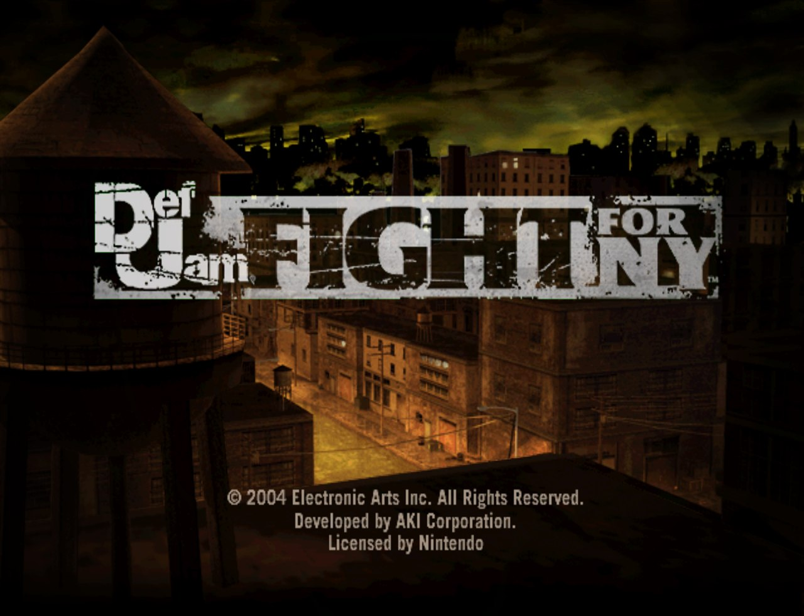
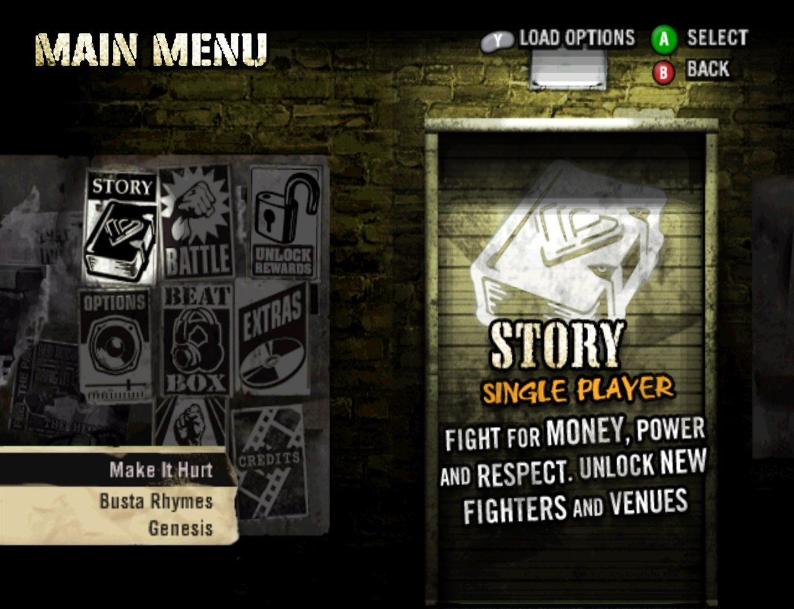
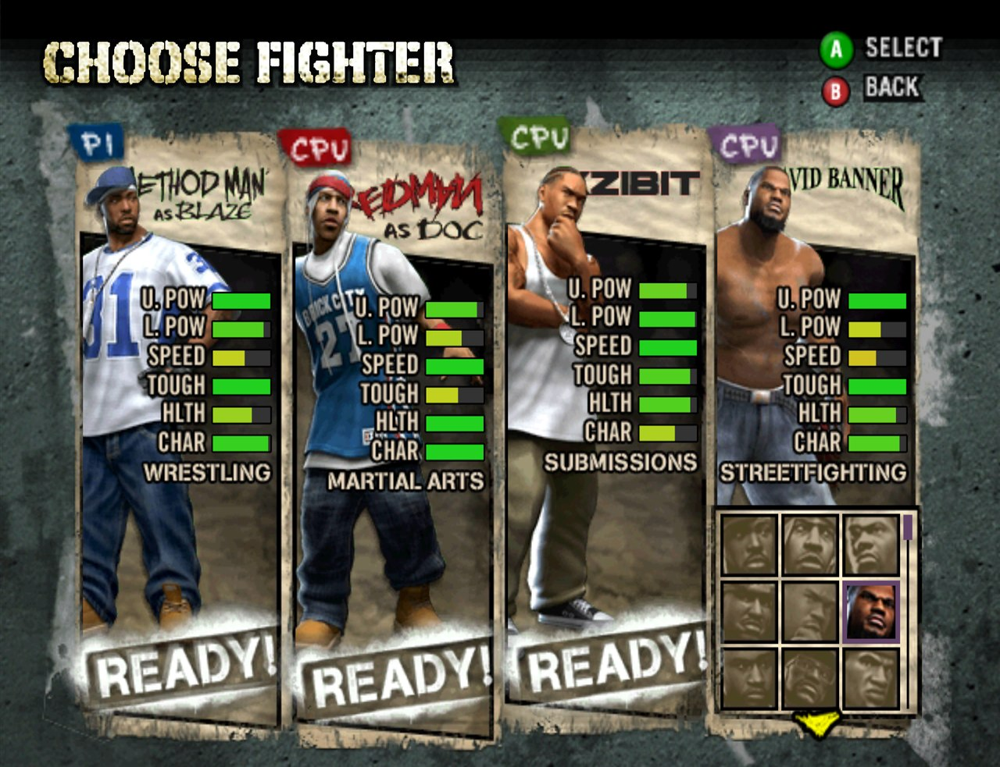
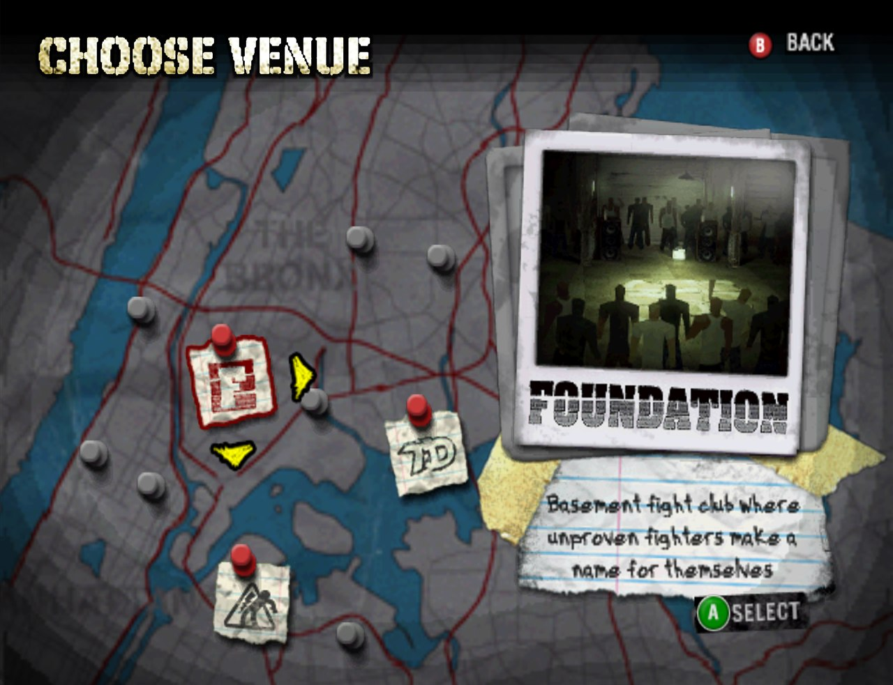
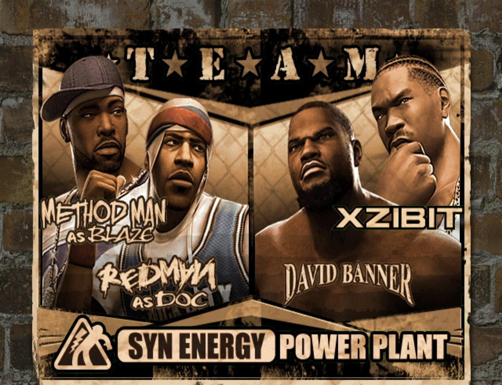
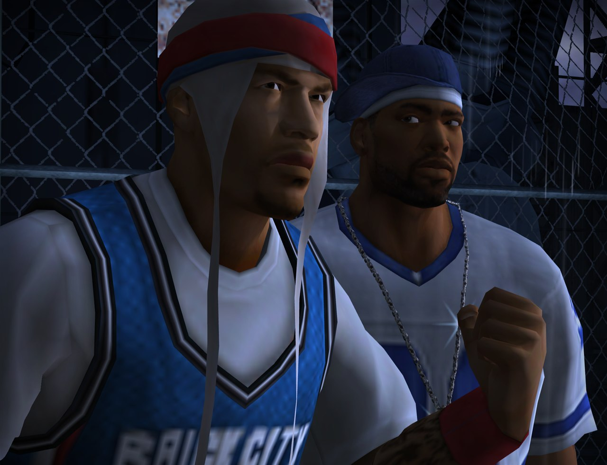
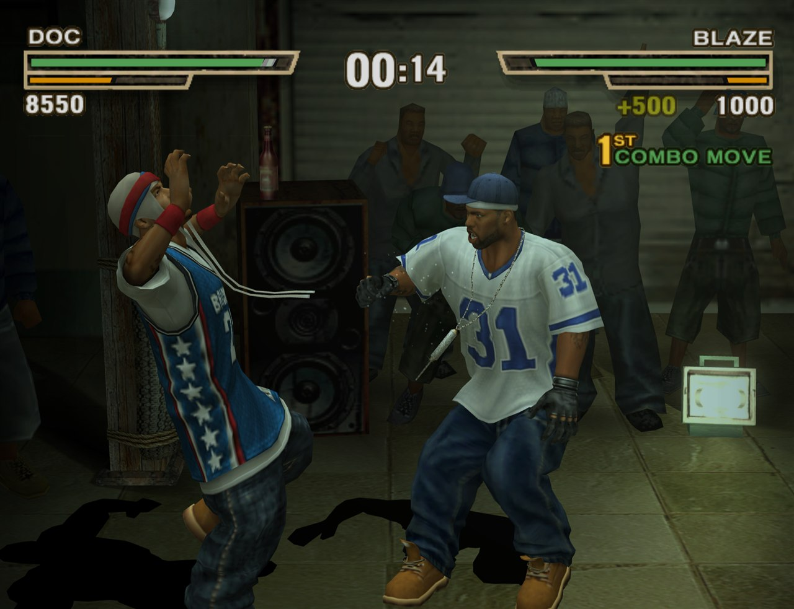
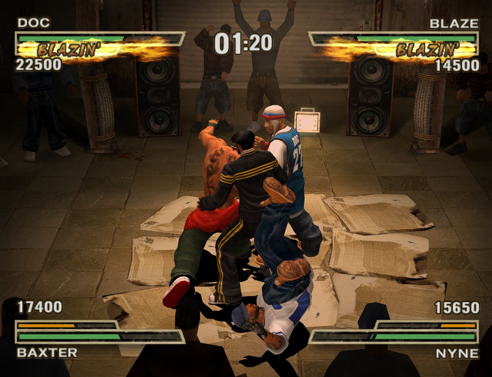
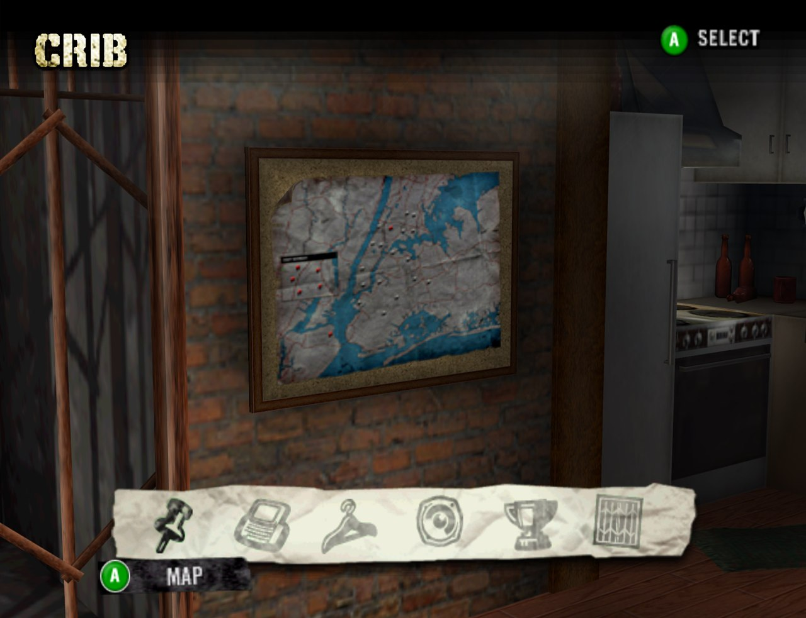

# Def Jam: Fight for NY — PC Recomp

<p align="center">
  
</p>

A native PC port of **Def Jam: Fight for NY** (GameCube, USA, disc ID `GNWE69`), built by
**static recompilation**. Nothing is emulated instruction by instruction: the game's PowerPC
executable is translated ahead of time into C, compiled for x86-64, and runs as native code
inside a Dolphin-derived runtime that provides the graphics, audio, input and the rest of the
console hardware.

> **No game data and no game code are included or distributed.** You supply a disc image of
> your own; everything derived from it (extracted files, recompiled code, the compiled game
> module) is generated on your PC and never leaves it.

## Screenshots

| | |
| --- | --- |
|  |  |
|  |  |
|  |  |
|  |  |

*Captured from the port at 3× internal resolution with 4× MSAA.*

## Features

- **The whole game, natively.** Story mode, Battle mode (1v1 up to 4-player free-for-all and
  2v2), every venue and fighter, at a locked 60 fps, including the heaviest 2v2 Blazin' moves.
- **Any resolution, any renderer.** Internal resolution up to 12×, anti-aliasing, anisotropic
  filtering, post-processing filters (CRT, scanlines, FXAA, ...), Vulkan, Direct3D 11/12 or
  OpenGL.
- **In-game settings menu.** Esc opens video, audio, system, controls, cheats, mods, save
  states, replays and screenshots, with a description of every setting.
- **Modern controllers.** Any SDL gamepad and the keyboard, with the button layout of the
  PlayStation 2, Xbox or GameCube release, picked automatically from the pad you use.
- **Button icons that match your controller.** The game's on-screen prompts are redrawn as
  PlayStation, Xbox, Switch, GameCube or keyboard icons, and follow whatever you last pressed.
- **Online play.** Netplay over the internet with a host code (no port forwarding), or over a
  LAN or VPN.
- **What the GameCube release left out.** Still on its disc, switched back on as on the other
  consoles: the Sketch Artist's voice page (pick your created fighter's voice out of six), the
  trailer in *Extras* and the menus' spotlight.
- **Mods.** Drop-in texture replacements and game-file mods, switched on and off in game,
  without ever touching the game's own files. Includes a tool for the game's `.viv` archives.
- **Optimize for this PC.** An optional, unattended profile-guided build that plays the game
  on its own for a few minutes and rebuilds it about 25% faster.
- **Built from source on your machine.** The installer ships the runtime, the recompiler and a
  trimmed Clang toolchain, and builds the game from your disc in a few minutes. No
  administrator rights; everything stays in the install folder.

## Playing

> [!IMPORTANT]
> The port needs a **plain `.iso`** of **Def Jam: Fight for NY for GameCube, USA release
> (`GNWE69`)**, dumped from your own copy. Other formats (`.rvz`, `.gcz`, `.wia`, `.ciso`,
> `.nkit.iso`) are not accepted as they are: convert them first with
> [Dolphin](https://dolphin-emu.org): right-click the game > *Convert File...* > Format **ISO**,
> no compression.

1. Get the installer, `DefJamFFNY-Setup-<version>.exe`, from the
   [Releases](https://github.com/Nakamizake/Def-Jam-Fight-for-NY-Recomp/releases) page.
2. Have your `.iso` ready (see above).
3. Run the installer and point it at the `.iso` (it is found automatically when it sits next
   to the installer). The game is built right after installing: about 5–8 minutes.
4. Start the game. Alt+Enter toggles fullscreen, Esc opens the settings menu.

Requirements: 64-bit Windows 10 or 11, a GPU with Vulkan or Direct3D 11, and about 6 GB of
free space while building (about 2 GB afterwards).

See the [player guide](docs/playing.md) for controls, the settings menu, netplay and
updating, and the [modding guide](docs/modding.md) to make or install mods.

## How it works

| Stage | Tool | Output |
| --- | --- | --- |
| Extract the disc | `dolrecomp extract` | `sys/main.dol` and the game files |
| Recompile `main.dol` | DolRecomp (C backend) | generated C sources |
| Build the game module | Clang (llvm-mingw) | `gGNWE69_recomp.dll` |
| Run | ModernGekko runtime (`moderngekko-run.exe`) | the game |

The port is built on [RingOut](https://github.com/jackpoison-prog/RingOut), a SoulCalibur II
port whose fork of [DolRecomp](https://github.com/ExpansionPak/DolRecomp) and
[ModernGekko](https://github.com/ExpansionPak/ModernGekko) is much faster than upstream. This
repository adds everything specific to Def Jam: recompiler settings and native regions, game
settings, controller layouts and button icons, fixes and features for the runtime (kept as
patches on top of RingOut), the installer, and the build, benchmark and training scripts.

To build it yourself, see [docs/building.md](docs/building.md).

## Repository layout

```
lib/RingOut/        submodule: RingOut's DolRecomp + ModernGekko, and the game-module CMake project
patches/RingOut/    this port's changes to lib/RingOut, applied by scripts/build-tools.ps1
config/             recompiler flags and native regions, game settings, default Dolphin settings,
                    controller layouts and the button icon art
scripts/            build, run, benchmark, training and packaging scripts (PowerShell)
installer/          Inno Setup script, the DefJam.exe launcher and the on-PC build script
tools-src/          the .viv modding tool, the PS2 extras builder, profiling and diagnostics
                    helpers, the glyph generator
docs/               guides and screenshots
```

Local folders, all git-ignored: `disc/` and `extracted/` (your disc image and its files),
`build/` (all build output), `tools/` (portable toolchain) and `userdata/` (settings, saves and
logs when running from a clone).

## Documentation

- [Player guide](docs/playing.md): controls, settings menu, button icons, netplay, updating.
- [Modding guide](docs/modding.md): textures, game files, `.viv` archives.
- [Building from source](docs/building.md): toolchain, build steps, performance, diagnostics.
- [External footprint](docs/external-footprint.md): everything the project writes outside its
  own folder, and how to remove it.

## Credits

- [RingOut](https://github.com/jackpoison-prog/RingOut) by jackpoison-prog — the static
  recompilation stack this port is built on.
- [DolRecomp](https://github.com/ExpansionPak/DolRecomp) and
  [ModernGekko](https://github.com/ExpansionPak/ModernGekko) by ExpansionPak.
- The [Dolphin](https://dolphin-emu.org) project, whose code provides the hardware emulation
  around the recompiled game, and whose traversal server introduces netplay peers.
- [llvm-mingw](https://github.com/mstorsjo/llvm-mingw), [SDL](https://www.libsdl.org),
  [Dear ImGui](https://github.com/ocornut/imgui) and [Inno Setup](https://jrsoftware.org/isinfo.php).

## Legal

This is a fan-made, non-commercial project, not affiliated with or endorsed by Electronic Arts,
AKI Corporation, Nintendo or any other rights holder. *Def Jam: Fight for NY* and all related
names and marks belong to their respective owners. You need your own legally obtained copy of
the game to use this project.

## License

[GPL-3.0-or-later](LICENSE), to match DolRecomp and ModernGekko. The RingOut submodule and the
bundled third-party components keep their own licences.
